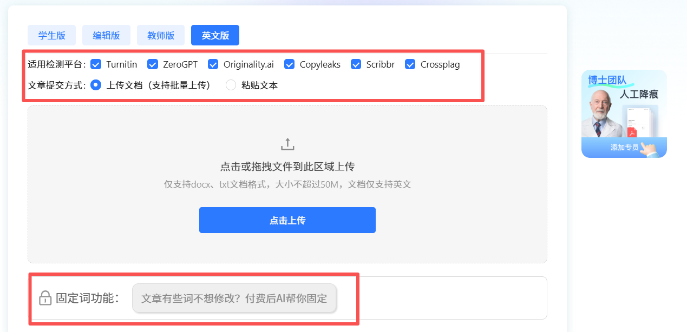
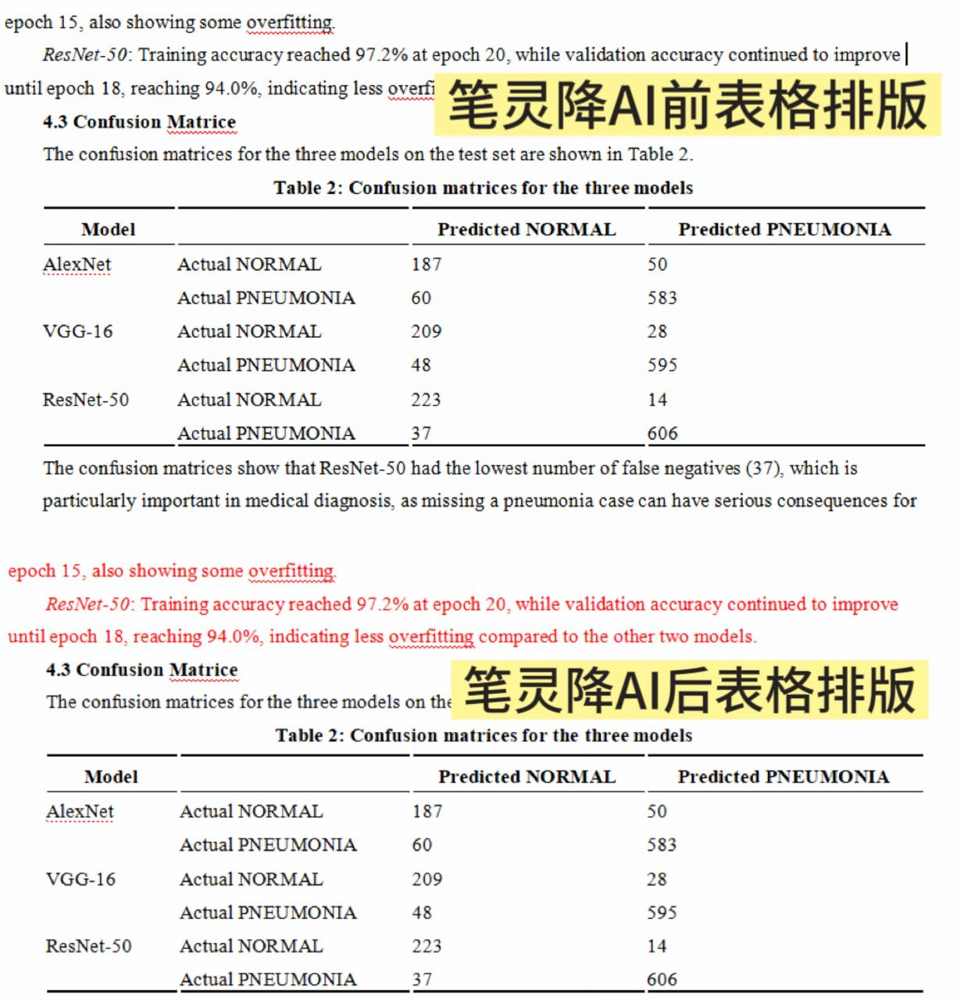
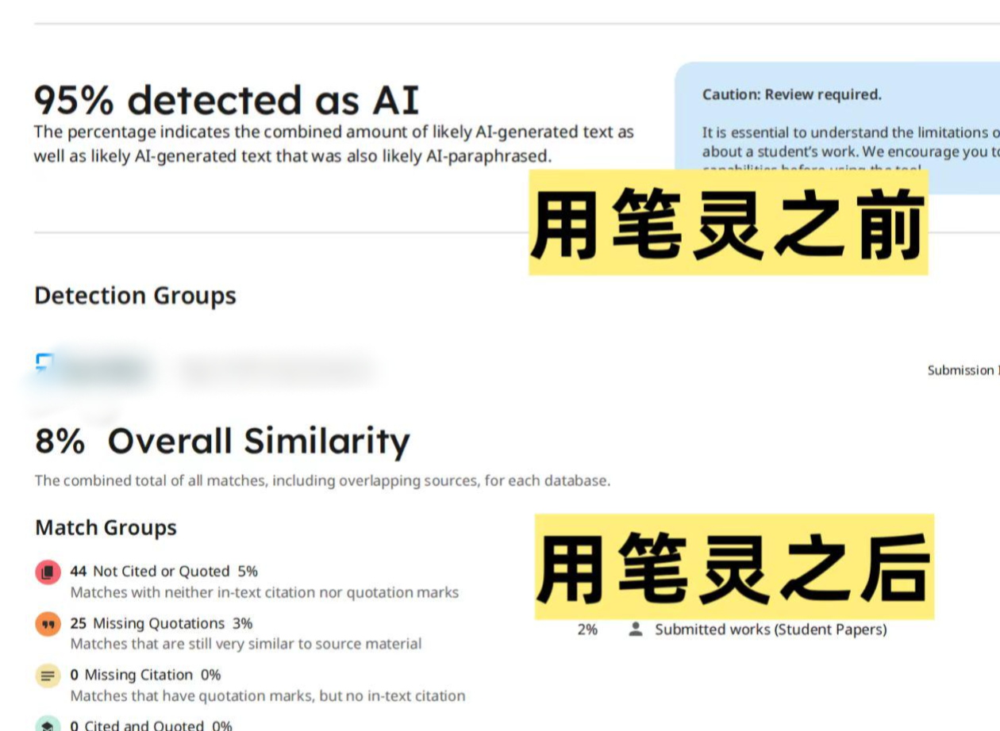

# 英文文稿 AI 率不理想？4款英文降AI工具实测参考

撰写英文长稿件之后，不少小伙伴在做降 ai 率自查时，会发现文本 AI 相关指标达不到预期。

我先后用多个主流平台查看指标，数值波动比较大，了优化文稿表达质感，各类**英文降 ai 率工具**、在线润色站点我尝试了不少。

很多工具仅替换近义词、打乱语序，修改完成后语句衔接生硬，踩坑多次之后，我慢慢总结出了实用的**英文降 ai 率的方法**，借助工具调整行文节奏，再手动通读打磨细节，文本阅读感自然改善了很多。

## 一、不盲目删改！新算法更新了判定逻辑

很多小伙伴看到自查结果不理想，第一反应就是大幅度修改甚至重写全文，但是大量修改之后，表达质感提升有限，还容易改动核心数据与观点，白白耗费大量时间。

2026 年 Turnitin 更新了判定逻辑，系统不再单纯比对文字重复，会综合考量句子节奏、行文逻辑、表达习惯，正式英文写作句式规整、逻辑递进清晰，文本特征容易被识别，很多原创稿件都会出现这类现象。

## 二、4 款热门英文文本优化工具实测测评

纯人工逐句打磨稿件需要投入大量时间精力，如果提交时间紧张，很难依靠人力完成全文优化。

我比较习惯先搭配合适工具辅助，可以减轻修改压力，优化文稿的自然质感，也实测了目前口碑不错的四款英文优化工具，帮大家横向对比参考，不用盲目查找各类**英文降 ai 率网站**挨个测试啦\~

### 1、笔灵英文降 AI

传送门： [https://u\.ibiling\.cn](https://ibiling.cn/paper-pass/english?from=githubywjiangai1009jw) 

笔灵是我 2026 实测下来表现最稳定的**英文降 ai 率工具**。短篇段落，或是上万字长稿件，都可以用来优化文本表达，在 Turnitin、ZeroGPT、Copyleaks、Originality 多个平台适配性都很不错。

它会通读整篇稿件理解上下文含义，重构句式语序，调整 AI 写作常见的模板化行文节奏，不过我最喜欢的还是它的内容锁定功能！

我们可以提前锁定专业术语、实验数据、专有名词以及核心论点，工具只会优化模板感偏重的句子，保留稿件本身的专业性。

另外，它的排版优势很突出！支持 docx、txt 完整文档批量上传，原稿段落结构、表格、注释、原有格式全部保留，我用下来效果也很明显，不用额外花时间手动调整排版。

这是我用笔灵修改之后的**英文AI率**，只要把文章导入进入、选定词语确保自己的专业内容不会被改变就可以顺利降下来啦，新手也可以无痛上手这套**英文降 ai 率的方法**，

### 2、DeepL Write

DeepL Write 很多人都用过，基础语法润色能力很强，不少人把它当作简易**英文降 ai 率网站**，适合用来修正中式英语，理顺语句表达，新用户上手简单，小段文本润色、拓宽表达思路都可以。

但它不太适合定稿阶段用来做**英文降 ai 率**优化，实测大篇幅英文稿件润色，偶尔会出现逻辑衔接不畅、内容删减、语句断裂等问题，后续需要花费不少精力调整。

而且它的改写偏向保守，大多只微调个别词汇，很难改善深层模板表达，只适合小段文字润色，不建议用来整篇稿件批量调整。

### 3、降重鸟

降重鸟属于轻量化的**英文降 ai 率工具**，新用户注册有免费试用额度，主打英文润色，可以针对局部机器感偏重的段落做轻度提质。实测改写后的句子基本没有语法错误。

短板在于改写深度有限，面对长复合从句很难充分优化，不容易调整模板化行文习惯。

而且对复杂排版兼容性一般，如果稿件带有表格、多层格式，改写后排版容易错乱，需要手动调整。

### 4、SpeedAI

SpeedAI 上手简单，自带简易英文 AI 自查功能，很多新手查找**英文降 ai 率工具**都会刷到它，我使用下来感觉他适合临时处理短句、小段文本做基础润色，毕竟改写的速度很快，应急还是没问题的。

但它的改写只停留在文本表层，只能做简单长句拆分、替换词汇，很难改善深层模板表达，处理长文本时，文本优化效果有限。

## 三、聊聊文稿文风优化的核心思路

做好**英文降 ai 率**相关的文本润色，并没有想象那么难，不用不停切换各类网站反复测试指标，陷入无效内耗，也不用完全依靠纯手动改写。

用好工具的话，会省下不少时间，稿件读起来也更自然，核心观点也不会出错。 

最后提醒，工具只能作为写作辅助。优化完成一定要通读全文，统一文风，仔细核对所有关键信息，掌握适合自己的**英文降 ai 率的方法**，保留原创表达是文稿写作里很关键的一点哦。

